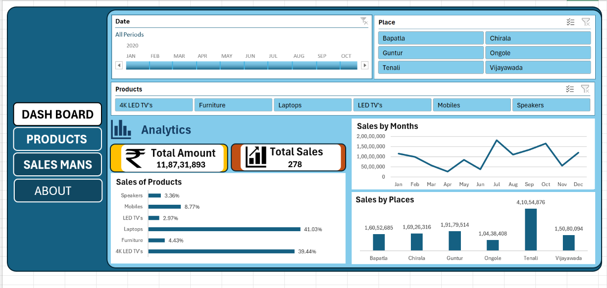
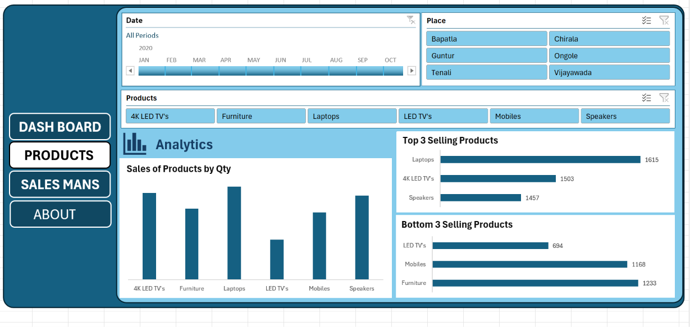
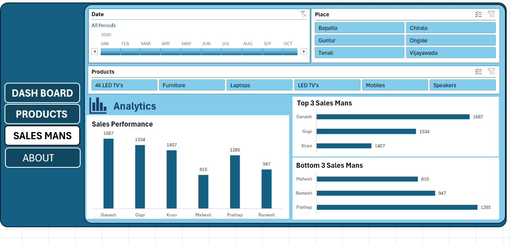

# Sales Performance Analysis

## Project Overview
This project focuses on analyzing sales data using Microsoft Excel and MySQL to understand business performance, identify sales trends, and generate meaningful insights.

## Objectives
- Analyze overall sales performance and revenue.
- Evaluate product-wise sales performance.
- Analyze salesperson-wise performance.
- Identify sales trends and business insights.
- Build an interactive Excel dashboard for data visualization.

## Tools & Technologies
- **Microsoft Excel:** Data analysis, Pivot Tables, charts, and dashboard creation.
- **MySQL:** Data querying and sales analysis.

## Project Structure
- `Dataset/` – Sales dataset.
- `Excel-Dashboard/` – Excel dashboard workbook.
- `SQL/` – SQL queries used for analysis.
- `Dashboard-Screenshots/` – Dashboard screenshots.

## Dashboard Preview

### Sales Dashboard

### Product Analysis

### Salesperson Analysis

## Key Insights
The project explores sales performance across products, salespersons, and other business dimensions to support data-driven decision-making.

## Author
**Yaswanth Tippiri**

[GitHub](https://github.com/yaswanthtippiri)
